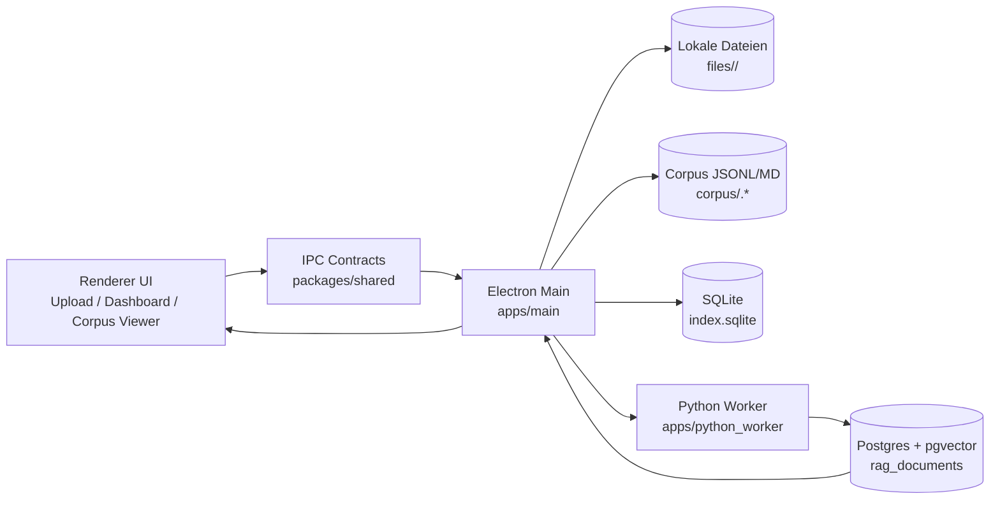

# RAG Ingest Studio + RAG Chat

**Sprache:** [Deutsch](README.md) | [English](README.en.md)

Desktop-Stack (Electron + React + TypeScript + FastAPI) fuer lokale Dokument-Ingestion und Chat ueber Vektor-Retrieval:

- Upload per File Picker, Drag & Drop und rekursiver Ordner-Ingest
- Parsing + Chunking + lokale Embeddings (Python Worker)
- Vektor-Backends pro Umgebung:
  - `postgres` (pgvector)
  - `sqlite_embedded` (ohne separaten Server)
  - `qdrant_embedded` (lokaler Qdrant-Speicherordner, ohne separaten Server)
- **Umgebungs-Familien / Matrix:** Embedding × Chunk-Size × Overlap (%) als Instanzen einer Familie; Indexierung pro Instanz oder sequentiell fuer die ganze Familie
- Lokale Index-DB in SQLite (`index.sqlite`) fuer Dokument-/Job-Metadaten
- Editierbarer Corpus als JSONL (optional Markdown)
- Reindex pro Dokument, Bulk, "Alle neu indexieren" und **Familie indexieren**
- **adminWeb:** Browser-Admin (Dokumente, Modelle, Settings, Bulktest) gegen die documentApi
- Chat-UI mit Quellenlinks (extern) und Antwort-Metriken (Dauer, Tokens, Tokens/s)

## Monorepo Struktur

```text
documentHandling/    Dokumentverwaltung + Ingestion UI (Electron)
chatBot/             Chat UI (Electron)
adminWeb/            Browser-Admin UI (Vite/React) fuer documentApi
documentApi/         FastAPI Backend + Worker + Vector Stores
scripts/             Startskripte (u. a. documentApi Runner)
batchTest/           Batch-Chat gegen die API + Excel-Export (Python)
docker/              Optionaler Compose-Stack
```

## Systemdiagramm (Ingest + Reindex)



### Was das Diagramm genau zeigt

1. **UI startet den Prozess**  
   Im Renderer waehlt der User Dateien aus (Picker oder Drag & Drop), sieht Status im Dashboard und kann Reindex/Remove ausloesen.

2. **IPC entkoppelt Frontend und Backend**  
   Die UI spricht nie direkt mit Dateisystem, Python oder Postgres. Sie sendet nur typisierte IPC-Requests ueber `packages/shared`.

3. **Electron Main orchestriert alles**  
   Der Main Process ist die zentrale Steuerung: Er nimmt Jobs an, schreibt Metadaten in SQLite, verwaltet Dateipfade und koordiniert den Worker.

4. **Lokale Artefakte werden persistiert**  
   Originaldateien landen in `files/<docId>/`.  
   Der editierbare Corpus wird als `corpus/<docId>.jsonl` (optional `.md`) gespeichert und dient als Source of Truth fuer spaetere Reindex-Laeufe.

5. **Python Worker macht Parsing + Embeddings**  
   Der Worker liest den lokalen Input, fuehrt Parsing/Chunking aus und erzeugt Embeddings fuer die Chunks.

6. **Postgres (pgvector) speichert die Vektoren fuer Retrieval**  
   Die erzeugten Punkte werden in `rag_documents` geschrieben. Vor Reindex werden bestehende Punkte des Dokuments entfernt, damit der Zustand idempotent bleibt.

7. **Rueckmeldung an die UI**  
   Der Main Process aktualisiert Job-/Dokumentstatus in SQLite und liefert den Fortschritt zurueck an die UI, damit Dashboard und Corpus Viewer den aktuellen Stand anzeigen.

## Installation & Start

Einrichtung, Entwicklungsstart, API-Keys und Production-Build: **[install.md](install.md)** (Englisch: [install.en.md](install.en.md))

Docker-Stack (optional): **[docker/README.md](docker/README.md)**

## Datenablage / Offline Verhalten

Alle Artefakte liegen lokal in:

`~/RAGIngestStudio/`

Unterstruktur:

- `files/<docId>/` - Originaldateien
- `corpus/<docId>.jsonl` - editierbare Source of Truth
- `corpus/<docId>.md` - optionaler Markdown-Export
- `index.sqlite` - Dokumente + Jobs
- `settings.json` - lokale Einstellungen (inkl. Vektor-Backend pro Umgebung)
- `vector_sqlite/` - Speicher fuer `sqlite_embedded`
- `vector_qdrant/` - Speicher fuer `qdrant_embedded`

## Kern-Funktionen

- **Dashboard** mit Filter/Suche, Status, Chunk-Anzahl, Bulk-Aktionen
- **Upload** per Picker oder Drag & Drop
- **Corpus Viewer** (editierbar), Speichern + Reindex
- **Settings** pro Umgebung inkl. Backend-Auswahl (`postgres`, `sqlite_embedded`, `qdrant_embedded`)
- **Umgebungs-Matrix:** Familien mit mehreren Instanzen (Embedding/Chunk/Overlap-%); Anzeige der Instanzanzahl; speichern der Matrix legt die Instanzen an (ohne Auto-Index)
- **Familie indexieren:** sequentiell alle Instanzen einer Familie neu chunken/embedden
- **Connection Test** backend-spezifisch (Postgres/SQLite/Qdrant)
- **CSV Export** der Dokumentliste
- **adminWeb Bulktest:** Fragen-Dateien, LLM-Judge (inkl. Claim-Level), Test-Profile speichern, Familien-Sequenzlauf mit Fortschritt/`familyRunId`
- **Chat** mit Quellenanzeige, "Website"-Button (externer Browser), Copy-Button und Antwort-Metriken

## batchTest (Batch-Chat + Excel)

Im Ordner `batchTest/` liegt ein kleines **Python**-Tool, das viele Chat-Fragen gegen die laufende **documentApi** schickt und eine **Excel-Arbeitsmappe** mit Antworten, Token-Metriken, Geschwindigkeit und den gezogenen Kontext-Chunks schreibt.

> English: [README.en.md](README.en.md) — same **batchTest** section.

### Voraussetzungen

- **documentApi** erreichbar (gleiche URL wie die App, Standard `http://localhost:8000`)
- Derselbe Index/Vektor-Backend wie im Chat, damit das Retrieval zu euren Dokumenten passt
- Abhaengigkeiten: `pip install -r batchTest/requirements.txt` (`httpx`, `openpyxl`)

### Kurzstart

```bash
cd batchTest
pip install -r requirements.txt
cp batch_config.example.json batch_config.json
# batch_config.json anpassen (Fragen, API-URL, optionale Chat-Settings)
python batch_chat.py --config batch_config.json
```

Unter Windows (PowerShell) geht `cp` nicht immer; dann z. B. `Copy-Item batch_config.example.json batch_config.json`.

### Konfiguration (`batch_config.json`)

| Bereich | Bedeutung |
|--------|-----------|
| `apiBaseUrl` | Basis-URL der documentApi (ohne abschliessenden Slash) |
| `requestTimeoutSeconds` | HTTP-Timeout pro Anfrage |
| `questions` | Liste von Fragen (Strings) |
| `questionsFile` | Optionaler Pfad zu einer Textdatei: eine Frage pro Zeile; Zeilen mit `#` sind Kommentare |
| `language` | `"de"` oder `"en"`, oder weglassen (wie in der API) |
| `history` | Optional Liste aus `{"role":"user"|"assistant","content":"..."}` (wie Chat-API) |
| `applyChatSettings` | Bei `true`: aktuelle Einstellungen per `GET /api/chat/settings` laden, mit `chatSettings` mergen, danach per `PUT` speichern |
| `chatSettings` | Gleiche Felder wie im App-Chat: `llmApiKey`, `llmBaseUrl`, `llmModel`, `temperature`, `maxTokens`, `topK`, `systemPrompt`, `encryptionKey` (CamelCase wie in der API) |
| `restoreChatSettingsAfterRun` | Bei `true`: nach dem Lauf die zuvor gesicherten Settings wiederherstellen |
| `outputExcel` | Pfad zur `.xlsx`-Ausgabe (relative Pfade beziehen sich auf das **aktuelle Arbeitsverzeichnis**) |

### Excel-Ausgabe

Die Arbeitsmappe enthaelt:

- **Meta** – Zeitstempel (UTC), API-URL, Konfigurationspfad, optional angewendete `chatSettings`
- **Ergebnisse** – eine Zeile pro Frage: Antwort, HTTP-Fehler (falls vorhanden), `elapsedMs`, Prompt-/Completion-/Total-Tokens, Tokens/s, Chunk-Anzahl, Kurzliste der Chunks, ausfuehrlicher Chunk-Text
- **Chunks** – eine Zeile pro abgerufenem Chunk: Frage-Nr., Position, Dateiname, `chunkIndex`, `documentId`, Aehnlichkeit, Quelle, Textauszug

Lange Texte werden bei Bedarf wegen Excel-Zelllimits gekuerzt.

## Hinweise zu Idempotenz

- Vor jedem Reindex werden bestehende Vektoren fuer `documentId` aus Postgres entfernt.
- Point IDs sind deterministisch via `sha256(documentId + ":" + chunkIndex)`.
- JSONL bleibt die editierbare Truth-Quelle fuer spaetere Reindex-Laeufe.
